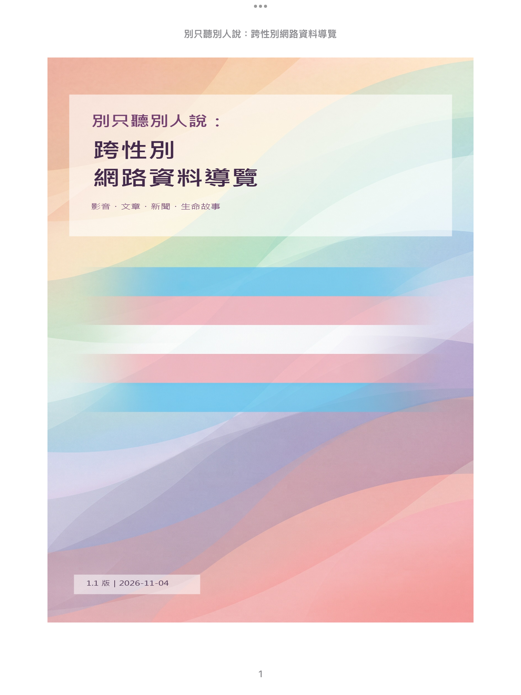
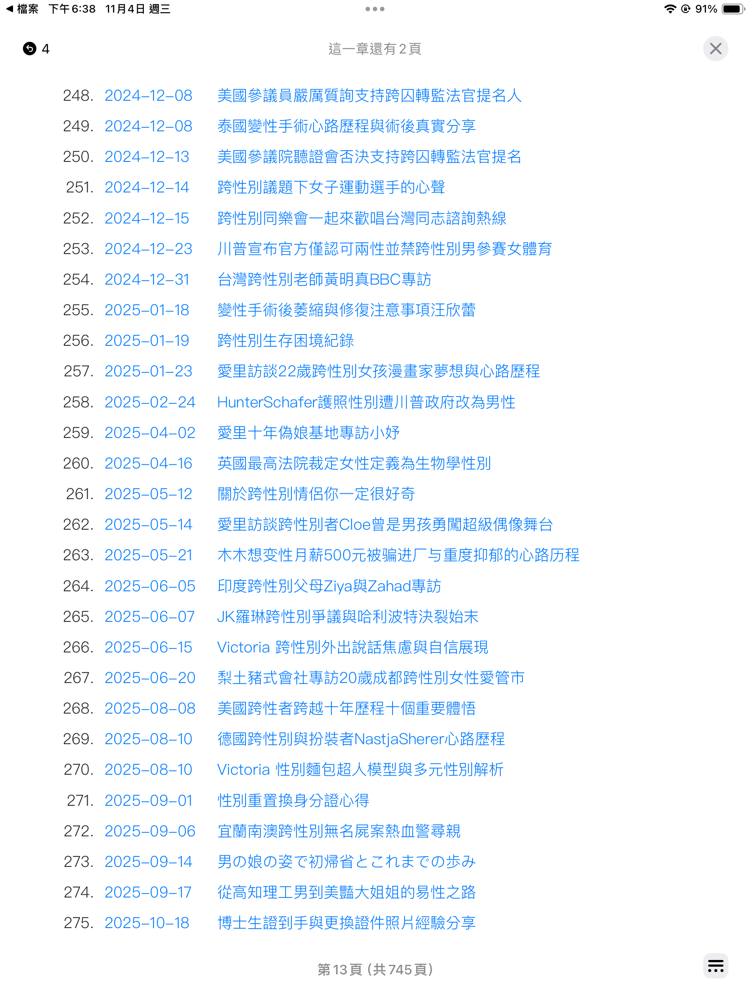
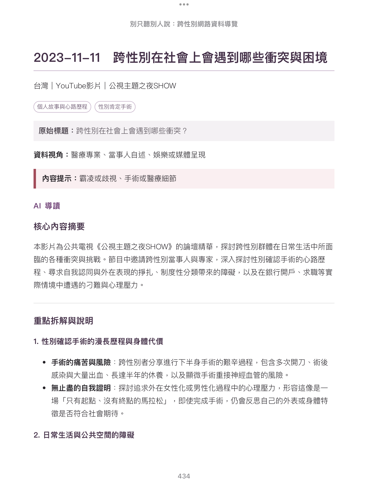

# trans-ebook

---
《別只聽別人說：跨性別網路資料導覽》簡介

大約在 2008～2010 年時，我根據自己的人生感受推算，這世界普遍來說應該要有「心理認同、生理、性傾向」三種維度、共八種類型的身心性模型；而在這之前，我一直以為一個人只有生理及性傾向兩種維度的四種模式。當我推導出可能有「心理認同」層面時，我還是不時懷疑：真的有這樣的人嗎？（當然，今天的我們知道有更多混搭不同狀態的種類。）

一直到差不多 2020 年時，我在 YouTube 發現有跨性別族群，或是說有心理認同性別這議題。拜當代網路演算法之賜，我看過什麼就推什麼給我，漸漸地知道越來越多關於跨性別的資訊。

為了能輕鬆找到已經瀏覽過的資料，2023 年 11 月 25 日，我把歷年看過的網頁、YouTube、Facebook 頁面整理分享在 [Google Blogger](https://tyuan.blogspot.com/2024/03/blog-post_16.html) 上。最初是設計成以類別區分，隨著資料增加，很快就發現難以在一頁裡設計成隨想取用的資料區域，而且日後還要能以合理成本維護。

拜 AI 之賜，2026-09 開始重新整理部落格資料後，決定朝電子書形式呈現，僅保留類似人物特寫、最生活面的資料。

我需要一種媒體表達方式，讓日常沒接觸過跨性別的人，不必一篇篇影片去看，而是能先看到一些輪廓，真的有興趣才深入。以前要找資料受到來源、時間與語言的限制，現在不用了；我們有 AI，而且是用最便宜的模式就能開始深入。

尤其對於那些只是一路聽人家說的人，可以在本書看到跨性別者的生活是怎麼過、思想是怎麼開展、他們的難處在哪、他們的年紀範圍與社會地位……。這本電子書能牽引出活生生跨性別族群的生命相貌。

主要內容以跨性別議題為主，輔以加強主題的 LGBTQ 訊息，都是多年來瀏覽網路訊息後紀錄整理的，基本上只以時間為主軸。目的是讓人們輕鬆閱讀每份網路資料的核心概念，有興趣可以進而利用連結看相關文件或影片。

## 📥 最新版本下載 (Latest Release)

目前最新版本為 **v1.1.1**，請至 **[GitHub Releases 頁面](https://github.com/tyuan4net/trans-ebook/releases/latest)** 下載最新檔案：

* 📖 **EPUB 格式**（適合手機、iPad Apple Books、Kobo、Kindle）：[`trans-ebook-v1.1.1.epub`](https://github.com/tyuan4net/trans-ebook/releases/latest/download/trans-ebook-v1.1.1.epub)
* 📄 **PDF 格式**（適合大螢幕排版閱讀）：[`trans-ebook-v1.1.1.pdf`](https://github.com/tyuan4net/trans-ebook/releases/latest/download/trans-ebook-v1.1.1.pdf)

> 💡 **提示**：若使用 Kindle，可下載 `.epub` 檔透過 [Amazon Send to Kindle](https://www.amazon.com/sendtokindle) 網頁直接傳送至裝置閱讀。

--- Tein Horng Yuan 2026-10-27

 

